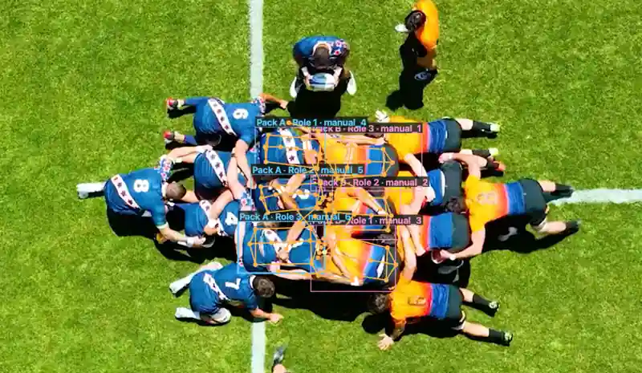

# ラグビースクラムの映像解析 — 研究紹介

[English](README.md) | **日本語**

**堀 晃成 · 立命館大学 · 学部卒業研究（2026年10月〜現在）**

> **研究状況：初期段階の研究プロトタイプ。** このページは、採用担当者や共同研究に関心のある方に向けた公開用の研究概要です。研究本体のリポジトリ、ソースコード、データセット、元の試合映像は非公開です。

## 研究目的

試合映像からラグビーのスクラムを分析するため、**コンピュータビジョンと機械学習**の活用を検討しています。自身のラグビー競技経験をもとに、選手の姿勢・動作・チーム全体の連携を、客観的に評価できる情報へと変換することを長期的な目標としています。将来的には、以下のような活用を目指しています。

- **指導者：** スクラムの配置や技術的な弱点の振り返り
- **選手・アナリスト：** 姿勢・動作・スクラムの安定性の理解
- **将来の研究：** 審判の意思決定支援や安全性に関する指標の検討

これらはあくまで**研究目標**であり、現時点で実現・検証済みの機能ではありません。

## プロトタイプの可視化

*上空から撮影したスクラム映像を用いた、初期段階の可視化例です。画像中の選手の役割ラベルは**手動で付与**したもので、姿勢キーポイントはモデルが自動推定したものです。この画像は、精度検証済みの選手追跡、自動的なポジション認識、力の測定、反則分類を示すものではありません。*

[画像をフルサイズで見る](../../assets/scrum-research-progress.webp) 

### 現在の技術的アプローチ

1. **映像の選定と前処理：** スクラム場面を含む映像を選び、フレームやサンプルのメタデータを整理する。
2. **コンピュータビジョンによる出力の確認：** YOLO系の人物検出結果を含む、自動人物検出と17点の人体姿勢推定結果を確認する。
3. **可視化・目視確認：** サンプル映像に検出結果と姿勢情報を重ねて表示する。公開画像では選手の役割を手動で付与している。
4. **アノテーション設計：** スクラムの局面（形成、エンゲージメント、押し合い、解放など）を確認・分類するためのレビュー手順を準備する。
5. **今後のモデル開発：** フレーム間の選手対応付け、姿勢・動作特徴量、スクラムの安定性、将来的な判断支援への応用を検討する。

**使用技術・関連分野：** Python、コンピュータビジョン、YOLO系人物検出、人体姿勢推定、COCOキーポイント、映像前処理、データセット整備、時系列解析（今後検討）。

## 現在の制約・未検証事項

- **小規模な探索的試験**であり、対象は視点の異なる3試合のみです。
- 取得した人物検出結果とキーポイントは、人手で作成した正解データと**体系的に照合・検証できていません**。
- 局面アノテーション用の作業フローは用意していますが、今回の試験データでは**人手で検証済みの局面ラベルはまだありません**。
- 選手のIDをフレーム間で安定して対応付ける**自動的な複数人物追跡（Multi-Object Tracking）は未確立**です。公開画像を追跡精度の評価結果と解釈しないでください。
- 今回の公開内容に関して、独自の姿勢推定モデルやスクラム分類モデルの学習・評価はまだ行っていません。
- 現段階のデータから、**力の方向、負傷リスク、スクラムの安定性、審判の判断を信頼できる形で推定することはできません**。

## 今後の取り組み

- 映像をレビューし、選手の役割やスクラム局面について人手で確認したアノテーションを作成する。
- カメラ視点による人物検出・姿勢推定の品質の違いを評価する。
- フレーム間で選手を対応付ける追跡手法と、時系列特徴量を検討する。
- 性能や実用性を主張する前に、対象を限定した概念実証（PoC）を実装・評価する。

---
