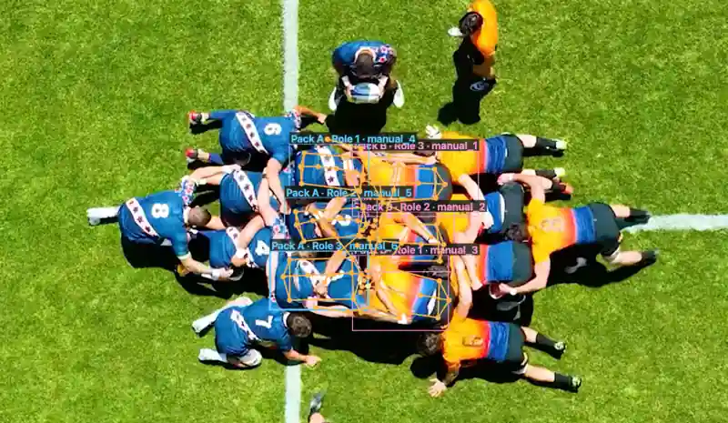

# Rugby Scrum Video Analysis — Research Showcase

**English** | [日本語](README.ja.md)

**Kosei Hori · Ritsumeikan University · Undergraduate research (October 2026–present)**

> **Status: early-stage research prototype.** This is a public overview for recruiters and collaborators. The main research repository, source code, datasets, and original videos are private.

## Research goal

I am exploring how **computer vision and machine learning** can help analyse rugby scrums from match footage. Drawing on my experience playing rugby, my long-term goal is to turn observations about player posture, movement, and team coordination into measurable evidence that could support:

- Coaches in reviewing scrum formations and technical weaknesses;
- Players and analysts in understanding posture, movement, and stability;
- Future research into decision support for referees and potential safety-related indicators.

These are **research goals**, not features already demonstrated or validated.

## Prototype visualisation

*Early-stage visualisation using aerial scrum footage. Player-role labels in this image were added manually; pose keypoints are automatically generated estimates. The image does **not** demonstrate validated player tracking, automated role recognition, force measurement, or penalty classification.*

[View the image at full resolution](../../assets/scrum-research-progress.webp) 

### Current technical approach

1. **Video selection and preparation:** identify scrum footage and organise frame/sample metadata.
2. **Computer-vision outputs:** inspect automatically generated person detections and 17-keypoint body-pose estimates, including YOLO-based detection outputs.
3. **Visual review:** display detections and pose information on example footage; manually identify player roles for the showcased example.
4. **Annotation design:** prepare a review workflow for scrum phases such as formation, engagement, drive, and release.
5. **Future modelling:** investigate player association across frames, posture and movement features, scrum stability, and eventually decision-support applications.

**Technologies / concepts:** Python, computer vision, YOLO-based person detection, human pose estimation, COCO keypoints, video preprocessing, dataset curation, and planned temporal analysis.

## Current limitations

- This is a **small exploratory pilot**, covering only three matches with different viewpoints.
- Recorded detections and keypoints have **not** yet been systematically verified against human ground truth.
- The phase annotation workflow exists, but **no manually verified phase labels** have been completed in the pilot at the time of this update.
- Stable player identities and automatic **multi-object tracking are not yet established**; a single image should not be interpreted as a tracking evaluation.
- No custom pose or scrum-classification model has been trained or evaluated for this showcase.
- Force direction, injury risk, scrum stability, and referee decisions **cannot currently be inferred reliably** from these data.

## Next steps

- Review footage and create manually checked annotations for player roles and scrum phases.
- Evaluate detection and pose quality across camera viewpoints.
- Explore robust player association/tracking across frames and temporal features.
- Build and evaluate a limited proof of concept before making any performance or real-world-use claims.

---

## 日本語概要

**研究テーマ：コンピュータビジョンと機械学習によるラグビースクラム映像解析**

長年のラグビー経験をきっかけに、試合映像から選手の姿勢・動作・配置を分析し、指導者による戦術評価や将来的な審判の判断支援に役立つ技術の研究を進めています。

現在は、スクラム映像から得られた人物検出結果と姿勢キーポイントを整理し、可視化やアノテーションの準備を進める**初期段階**です。上の画像では選手の役割を**手動で付与**しており、自動追跡や反則判定が実現したことを示すものではありません。

試験的に整理したデータは**3試合・5クリップ・279フレーム・人物検出1,378件・姿勢キーポイント23,426点**です。現時点でスクラムの局面について人手で検証済みのフレームラベルはありません。今後はデータの検証、選手追跡、時系列解析、モデルの評価へと進めます。

